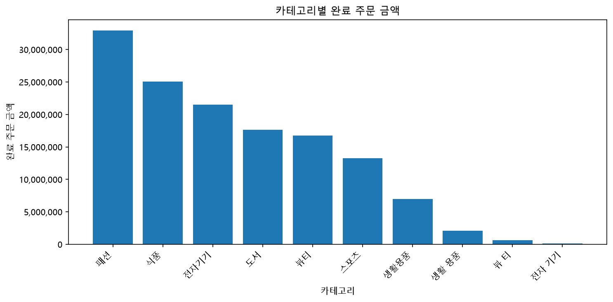
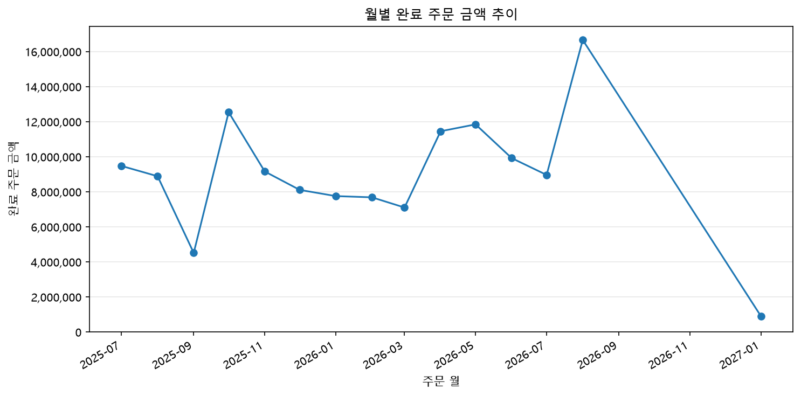
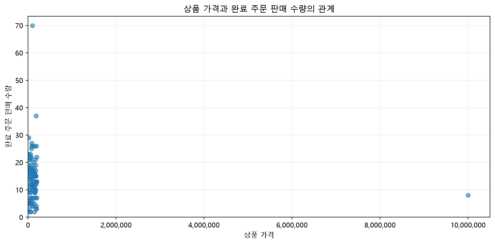

# Chapter 07 답안 양식. 그래프로 데이터의 이야기를 보여주기

> 이 내용을 `chapter07.ipynb`의 Markdown 셀로 작성합니다.

## 제출 정보
- 이름: 김희철
- GitHub ID: KHeeCheol
- 작성일: 2026-10-20
- 최종 Notebook URL: https://github.com/KHeeCheol/llm-data-analysis-study/blob/main/notebooks/chapter07.ipynb

## 1. 시각화 질문과 그래프 선택

| 질문 | 선택한 그래프 | 선택 이유 |
|---|---|---|
| 카테고리별 `completed` 주문 금액은 어떻게 다른가? | 막대그래프 | 카테고리별 금액 규모와 비중을 비교하기 적합하다. |
| 월별 `completed` 주문 금액은 어떻게 변하는가? | 선그래프 | 시간에 따른 금액 변화와 변동 구간을 확인할 수 있다. |
| 상품 가격과 `completed` 판매 수량 사이에는 어떤 패턴이 있는가? | 산점도 | 두 숫자형 변수의 관계와 극단값을 탐색하기 적합하다. |

금액 관련 분석은 Chapter 05의 clean CSV에서 PK/FK 참조관계가 검증된 데이터만을 대상으로 하였다. 기존 `data/processed`는 보존하고, Chapter 07 전용 데이터를 `data/ch07_processed`에 별도로 생성하였다.

## 2. 대표 그래프 1

### 원본 집계값

`completed` 주문 기준 금액 합계는 136,949,000원이다.

| 카테고리 | 완료 주문 금액 | 금액 비중 |
|---|---:|---:|
| 패션 | 32,940,000원 | 24.05% |
| 식품 | 25,035,000원 | 18.28% |
| 전자기기 | 21,485,000원 | 15.69% |

상위 3개 카테고리의 합계는 79,460,000원으로 전체 금액의 58.02%를 차지하였다. 카테고리별 집계 합계는 원본 `completed` 금액 136,949,000원과 일치하였다.

### 결과 관찰

패션의 완료 주문 금액이 가장 높았으며 식품과 전자기기가 뒤를 이었다. 상위 3개 카테고리가 전체 금액의 절반 이상을 차지하였고 집계표와 막대그래프의 값 및 정렬 순서가 일치하였다.

### 나의 해석과 판단
완료 주문 금액이 일부 카테고리에 집중되어 있어 해당 카테고리를 우선 분석할 필요가 있다고 판단하였다. 다만 금액 차이가 판매 수량, 상품 단가 또는 특정 고액 거래 중 어떤 요인에서 발생했는지는 구분해서 확인해야 한다.

### 업무·분석적 의미
카테고리별 금액 비중은 상품 운영 및 마케팅 분석의 우선순위를 설정하는 기초 자료로 활용할 수 있다. 특히 상위 카테고리에서 상품별 금액 기여도를 분석하면 핵심 상품군을 구체화할 수 있다.
### 한계와 추가 확인 사항
주문 금액만으로 고객 선호도나 수익성을 판단할 수 없다. 또한 `뷰티`와 `뷰 티`, `생활용품`과 `생활 용품`처럼 동일한 의미의 카테고리가 별도로 집계되어 있다.

향후 카테고리 표기를 통일하고 판매 수량·평균 단가·등록 상품 수와 상위 상품의 금액 기여도를 함께 비교할 필요가 있다.

## 3. 대표 그래프 2

### 원본 집계값
유효한 주문일을 가진 `completed` 주문 상세의 월별 금액 합계는 135,046,000원이다.

주요 월별 집계 결과는 다음과 같다.

| 주문 월 | 완료 주문 금액 | 완료 주문 수 | 평균 주문 금액 |
|---|---:|---:|---:|
| 2025-10 | 12,547,000원 | 17건 | 738,059원 |
| 2026-05 | 11,850,000원 | 12건 | 987,500원 |
| 2026-08 | 16,668,000원 | 15건 | 1,111,200원 |
| 2027-01 | 909,000원 | 1건 | 909,000원 |

주문일이 누락된 `completed` 상세 6행의 금액은 1,903,000원이며 이를 월별 합계에 더하면 전체 금액 136,949,000원과 일치한다.
### 결과 관찰
2026-08의 완료 주문 금액이 16,668,000원으로 가장 높았다. 2025-10은 완료 주문 수가 17건으로 더 많았지만 평균 주문 금액이 낮아 총금액은 12,547,000원으로 나타났다. 전체 기간에서 월별 금액은 일정한 증가 또는 감소보다는 변동하는 양상을 보였다.

### 나의 해석과 판단

월별 완료 주문 금액은 주문 건수와 평균 주문 금액의 영향을 함께 받는 것으로 판단하였다. 특히 2026-08의 높은 금액은 주문 건수만으로 설명하기 어려우며 상대적으로 높은 평균 주문 금액도 함께 고려할 필요가 있다.

### 업무·분석적 의미

월별 주문 수와 평균 주문 금액을 구분하여 분석하면 금액 변동의 주요 요인을 탐색할 수 있다. 금액이 높았던 기간의 상품 카테고리 및 고액 주문 비중을 추가 확인하면 마케팅 및 상품 운영에 활용할 수 있는 분석 질문을 도출할 수 있다.

### 한계와 추가 확인 사항

월별 금액 변화만으로 프로모션이나 계절성의 영향을 단정할 수 없다.

또한 2026-09부터 2026-12까지 관측 데이터가 없으므로 실제 주문이 0건이었다고 해석할 수 없다. 현재 선그래프는 해당 공백 구간을 직선으로 연결하여 지속적인 감소 추세처럼 보일 수 있다는 한계가 있다.

향후 데이터 수집 기간의 연속성을 확인하고, 월별 주문 수·평균 주문 금액·카테고리 구성을 함께 비교할 필요가 있다.

## 4. 대표 그래프 3

### 원본 집계값

한 점은 상품 하나를 의미하며, 상품 마스터의 `price`와 상품별 `completed_quantity`를 사용하였다.

실제 집계값 중 대표 사례는 다음과 같다.

| 상품 가격 | 완료 주문 판매 수량 | 완료 주문 금액 |
|---|---:|---:|
| 96,000원 | 70개 | 6,720,000원 |
| 183,000원 | 37개 | 6,771,000원 |
| 187,000원 | 26개 | 4,862,000원 |
| 193,000원 | 22개 | 4,246,000원 |

또한 `price=9,999,999`인 상품이 일반적인 가격대와 크게 떨어져 나타났다.

### 결과 관찰

대부분의 상품 가격은 20만 원 이하에 분포하였으며 상품별 완료 주문 판매 수량에는 상당한 차이가 있었다. 산점도에서 가격과 판매 수량 사이의 뚜렷한 선형 관계는 확인되지 않았다.

특히 9,999,999원의 극단적인 가격으로 인해 다른 상품들이 그래프 왼쪽에 압축되어 나타났다.

### 나의 해석과 판단

현재 데이터에서는 상품 가격만으로 판매 수량의 차이를 설명하기 어렵다고 판단하였다. 가격뿐 아니라 상품 카테고리, 수요 및 판매 조건 등 다른 요인이 영향을 미쳤을 가능성이 있다.

### 업무·분석적 의미

상품 가격과 판매 수량의 관계를 분석하면 가격대별 상품 운영 전략을 검토하는 데 활용할 수 있다. 특히 카테고리별로 가격과 판매 수량의 패턴을 분리하면 상품 구성 및 판매 특성에 관한 추가 분석이 가능하다.

### 한계와 추가 확인 사항

산점도에서 관찰되는 관계만으로 가격이 판매량에 미치는 인과관계를 판단할 수 없다. 또한 재고, 할인, 상품 노출, 판매 기간 등의 정보가 포함되어 있지 않다.

극단적인 가격은 실제 오류인지 확인되지 않았으므로 임의로 제거하지 않았다. 향후 일반 가격대를 확대한 보조 그래프를 작성하고, 카테고리별 가격과 판매 수량의 관계를 비교할 필요가 있다.

## 5. 그래프 정확성 점검
- [O] 그래프 값과 집계표 값 일치
- [O] 축 이름 확인
- [O] 단위 확인
- [O] 범례 확인
- [O] 날짜 정렬 확인
- [O] 과장될 수 있는 축 범위 확인
- [O] 제목이 분석 범위를 정확히 표현

### 내가 발견한 시각화 위험 또는 개선점
1. 카테고리 표기 불일치

- 문제: 동일한 의미의 카테고리가 서로 다른 항목으로 표시되었다.
- 위험: 카테고리별 금액 비중을 정확히 비교하기 어렵다.
- 개선점: 카테고리 표기를 표준화한 후 집계값과 그래프를 재검증할 필요가 있다.

2. 월별 관측 공백

- 문제: 2026-09~2026-12의 관측 데이터가 없지만 선그래프에서는 이전·이후 월이 연결되어 있다.
- 위험: 실제로 관측되지 않은 기간을 지속적인 감소 추세로 오해할 수 있다.
- 개선점: 데이터가 없는 기간의 선 연결을 끊고, 관측 공백을 명확하게 표시할 필요가 있다.

3. 상품 가격 극단값

- 문제: 9,999,999원의 극단적인 가격으로 인해 히스토그램과 산점도에서 일반 가격대가 압축되었다.
- 위험: 대부분의 상품 가격 분포와 관계를 파악하기 어렵다.
- 개선점: 원본 데이터를 유지하면서 일반 가격대를 확대한 보조 그래프를 추가하는 방법이 적절하다.

위 사항들은 발견한 개선점으로 기록하였으며 원본 데이터를 임의로 수정하지 않았다.

## 6. Chapter 07 최종 판단
### 가장 중요한 그래프 1개와 이유
가장 중요한 그래프는 **카테고리별 완료 주문 금액 막대그래프**라고 판단하였다.

카테고리별 금액 규모와 비중을 직관적으로 비교할 수 있으며 상품 운영 및 마케팅 분석의 우선순위를 설정하는 데 활용할 수 있기 때문이다.

### 그래프가 보여 준 사실

참조관계 검증을 통과한 `completed` 주문 금액은 136,949,000원이었다. 패션이 32,940,000원(24.05%)으로 가장 높았으며 식품과 전자기기가 뒤를 이었다.

상위 3개 카테고리의 금액 비중은 58.02%였으며 집계표와 그래프의 수치가 일치함을 확인하였다.

### 그래프만으로 말할 수 없는 것

완료 주문 금액이 높다는 사실만으로 고객 선호도, 상품의 수익성 또는 마케팅 효과를 단정할 수 없다.  
또한 이번 Chapter 07에서는 PK/FK 참조관계가 성립하지 않는 주문 및 상세 데이터를 제외하였기 때문에 Chapter 06과 분석 범위가 다르다. 전체 데이터에서 어떤 정보를 제외했는지도 결과 해석에 반영해야 한다.

### 다음 분석에서 확인할 질문

**카테고리별 완료 주문 금액 차이는 판매 수량, 평균 단가 및 상위 상품의 금액 기여도 중 어떤 요인과 더 밀접하게 관련되어 있는가?**

이를 확인하기 위해 카테고리 표기를 통일한 후 판매 수량, 평균 판매 단가, 상품 수 및 상위 상품의 금액 기여도를 비교하고자 한다.

## 최종 체크
- [O] 그래프와 수치를 교차 검증했습니다.
- [O] 관찰과 해석을 구분했습니다.
- [O] 업무적 의미와 한계를 작성했습니다.
- [O] 최종 Notebook URL을 제출합니다.

